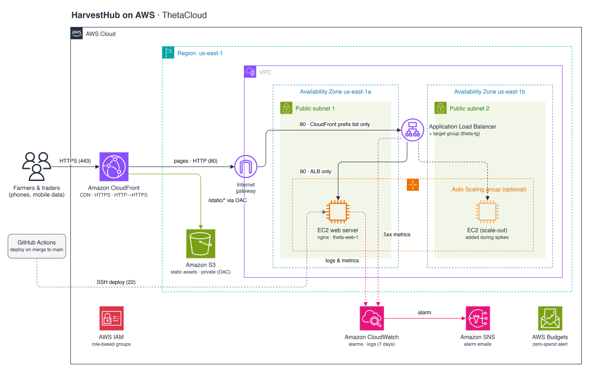

# HarvestHub on AWS: End-to-End Cloud Solution Design & Deployment

## About the project

ThetaCloud, a cloud solutions team, designed and deployed HarvestHub on AWS. HarvestHub is a fictional agri-tech startup that helps Ghana's smallholder farmers through the season: Plant → Store → Sell. The World Food Programme estimates Ghana loses about US$1.9 billion a year to post-harvest losses, around 30% of smallholder incomes ([source](https://gna.org.gh/2024/08/post-harvest-losses-impoverishing-ghanaian-farmers/)), and much of that comes from not having the right information at the right time. In one line: ThetaCloud designed and deployed HarvestHub on AWS for an agri-tech startup helping smallholder farmers.

**Live site: https://harvesthub.thetacloud.site**

---

## The Problem

HarvestHub's website is growing fast, but it has four technical problems, all on a limited budget:

- **Slow page loads**, especially on weak mobile data in farming areas
- **Crashes at peak times**, such as when new prices go up each morning
- **Security concerns**, because tampered prices or fake storage listings would cheat the farmers relying on them
- **Manual deploys**, with no structured process, so mistakes go live unchecked and developers overwrite each other's work

## Our Solution

We designed the platform for high availability, but it runs on one EC2 instance for now to stay within the budget.

Users reach the site at https://harvesthub.thetacloud.site over HTTPS through **Amazon CloudFront**, which routes requests by path:

- **`/static/*`** (images, CSS, JS) is cached by CloudFront and served from a private **S3** bucket, readable only by CloudFront through Origin Access Control (OAC).
- **Everything else** (pages and `/data/*.json`) is not cached and goes over HTTPS to an **Application Load Balancer**, which forwards it over HTTP on port 80 inside the VPC to **one EC2 instance** running nginx.

Security groups lock the path down: the ALB only accepts traffic from CloudFront, and the EC2 instance only accepts traffic from the ALB. **GitHub Actions** deploys the app to the instance through SSM.

### Architecture



**Design decisions**

- **HTTPS from the visitor to the load balancer.** Visitors connect to CloudFront over HTTPS, and CloudFront connects to the ALB over HTTPS on port 443 via `origin.harvesthub.thetacloud.site`, using the same ACM certificate. The ALB's port 80 listener redirects to 443. From the ALB to EC2, traffic uses HTTP on port 80 inside the VPC.
- **Public subnets for EC2.** Private subnets would need a NAT gateway (about $30+ a month), which breaks the budget. The instance sits in a public subnet, but its security group only accepts traffic from the ALB.
- **One EC2 instance for now.** A single instance (`theta-web-ec2`) keeps costs down, but if it or its Availability Zone fails, the site is down until it's restored. Auto Scaling is optional and not set up.
- **Custom domain.** The site runs on `harvesthub.thetacloud.site`, with DNS at Spaceship and the ACM certificate in `us-east-1`, the region CloudFront requires.
- **Caching.** CloudFront's default behaviour uses CachingDisabled, so pages and `/data/*.json` are never cached. Only `/static/*` is cached (CachingOptimized), so changed static files need an invalidation.

---

## Tech Stack

| Area              | Tools |
| ----------------- | ----- |
| Compute           | Amazon EC2 (`t3.micro`), 1 instance (`theta-web-ec2`, Amazon Linux 2023, nginx); Auto Scaling optional, not set up |
| Networking        | VPC (`theta-vpc`), 2 public subnets, Internet Gateway, no NAT gateway; DNS at Spaceship |
| Load balancing    | Application Load Balancer (`theta-alb`), target group (`theta-tg`) |
| CDN & HTTPS       | Amazon CloudFront, custom domain, ACM certificate in `us-east-1` |
| Storage           | Amazon S3 (`theta-assets-2026nov`, private through Origin Access Control) |
| Security          | IAM (least privilege), security groups, CloudFront managed prefix list, CloudTrail |
| CI/CD             | GitHub Actions (OIDC to `theta-github-deploy`, no stored access keys), deploys through SSM |
| Monitoring & cost | CloudWatch alarms and logs, SNS (`theta-alerts`), AWS Budgets (`theta-zero-spend`) |
| Collaboration     | GitHub, Trello |
| Web app           | HTML, CSS, JavaScript, Highcharts |

---

## Repository Structure

```
.
├── .github/
│   └── workflows/
│       └── deploy.yml           # Deploys to EC2 on every push to main
├── app/                         # Web application source
│   ├── about.html
│   ├── crops.html
│   ├── index.html
│   ├── plant.html
│   ├── sell.html
│   ├── services.html
│   ├── store.html
│   ├── data/                    # JSON data (served from EC2, not cached)
│   │   ├── calendar.json
│   │   ├── crops.json
│   │   ├── prices.json
│   │   └── storage.json
│   └── static/                  # Uploaded to S3 and served under /static/
│       ├── css/
│       │   ├── style.css
│       │   └── tokens.css       # Design system tokens
│       ├── images/              # Scene photos and crops/ photos
│       └── js/
│           ├── highcharts.js
│           ├── highcharts-heatmap.js
│           └── script.js
├── docs/
│   ├── architecture.svg         # Architecture diagram
│   ├── deployment-checklist.md  # Full rebuild order
│   ├── environment-setup.md     # Account, IAM groups, CLI, resource names
│   ├── image-credits.md         # Photo sources and licences
│   └── security.md              # Open ports, lockdown tests, troubleshooting
├── deploy.sh                    # Runs on the instance to update the site
├── LICENSE
└── README.md
```

## Local Testing

Pages load their data with `fetch`, so opening them directly from disk won't work. Run a local web server instead:

```bash
cd app
python3 -m http.server
```

Then open http://localhost:8000.

---

## Branching Strategy

| Branch                 | Purpose                                                                  |
| ---------------------- | ------------------------------------------------------------------------ |
| `main`                 | Production-ready code only. Pushes here trigger deployment.              |
| `Develop`              | Integration branch where finished features come together and get tested. |
| `feature/<short-name>` | One branch per task, e.g. `feature/alb-setup`, `feature/home-page`.      |

> Branch names are case-sensitive: the integration branch is `Develop` with a capital **D**.

**Workflow**

1. Pick a card on Trello and assign yourself.
2. Get the latest integration branch and branch from it:
   ```bash
   git fetch origin
   git checkout -b feature/<short-name> origin/Develop
   ```
3. Commit small, clear changes.
4. Open a Pull Request into `Develop` and get at least one teammate to review it.
5. When `Develop` is stable, open a PR from `Develop` into `main`.

No direct pushes to `main`.

---

## Environment Setup

### 1. AWS account & IAM

- We use one member's existing AWS account, in `us-east-1`.
- MFA is on the root user. Root was used only for first-time setup.
- Each member has one IAM user (`firstname.lastname`) in a role-based group, with no policies attached directly to users.
- CloudTrail records who did what.

| IAM group | Policies |
| --------- | -------- |
| Admin | AdministratorAccess (account owner, plus the Security Lead as backup admin) |
| Cloud_Architect | AmazonEC2FullAccess, CloudFrontFullAccess, AWSCertificateManagerReadOnly |
| Security | IAMFullAccess, AmazonEC2FullAccess, AmazonS3FullAccess, CloudFrontFullAccess, SecurityAudit, AWSCertificateManagerFullAccess |
| App_Developer | AmazonEC2FullAccess, theta-app-dev-s3-access (the `theta-assets-2026nov` bucket only) |
| DevOps | AmazonEC2ReadOnlyAccess, CloudWatchReadOnlyAccess, theta-devops-server-access |
| Monitoring_Docs | CloudWatchFullAccess, AmazonSNSFullAccess, ReadOnlyAccess |
| Cost_Presentation | Billing, ReadOnlyAccess |

### 2. AWS CLI

We use AWS CLI v2 in Ubuntu (WSL) with the profile `theta`. AWS CloudShell also works.

```bash
aws configure --profile theta
aws sts get-caller-identity --profile theta   # check it works
```

Never commit access keys to this repo.

### 3. Networking

- VPC `theta-vpc` (custom) with **two public subnets in different Availability Zones** and an Internet Gateway. There is no NAT gateway.
- DNS is at Spaceship, with no Route 53: `harvesthub` is a CNAME to CloudFront, and `origin.harvesthub` is a CNAME to the ALB.

### 4. Security groups

| Security group | Inbound rule | Source |
| -------------- | ------------ | ------ |
| `theta-alb-sg` | HTTPS 443    | CloudFront managed prefix list (`com.amazonaws.global.cloudfront.origin-facing`) |
| `theta-web-sg` | HTTP 80      | `theta-alb-sg` |

The ALB's port 80 listener redirects to 443, but port 80 isn't open in `theta-alb-sg`. SSH is removed: there is no port 22, and admin access goes through SSM. See [docs/security.md](docs/security.md) for the lockdown tests and troubleshooting.

### 5. EC2

- One instance: `theta-web-ec2` (`t3.micro`, Amazon Linux 2023, nginx) in a public subnet.
- Instance role: `theta-web-server-role` (AmazonSSMManagedInstanceCore, CloudWatchAgentServerPolicy).
- This repo is cloned to `/opt/app`, and nginx serves the site from `/opt/app/app`.
- The ALB (`theta-alb`, internet-facing, 2 AZs) forwards to the target group `theta-tg` (HTTP 80, health check `/`).

### 6. S3

- Bucket: `theta-assets-2026nov`, with Block all public access on.
- Files sit under `static/` in the bucket, from `app/static/` in this repo, and are served at `/static/*`.
- The bucket policy allows reads only from our CloudFront distribution through OAC (`theta-assets-oac`).

---

## How Deploys Work

1. A merge to `main` starts [`.github/workflows/deploy.yml`](.github/workflows/deploy.yml). The job uses the `production` GitHub environment.
2. GitHub Actions assumes the role `theta-github-deploy` through OIDC, with no stored access keys. The role trusts only this repo's `main` branch.
3. The workflow uses SSM (`AWS-RunShellScript`) to run [`deploy.sh`](deploy.sh) on the instance, then waits for the result and fails if the command didn't succeed.
4. `deploy.sh` resets `/opt/app` to the latest `origin/main` and reloads nginx.

**Static files are a separate step.** The workflow updates the pages and `/data/*.json` on EC2, but it doesn't upload `app/static/` to S3 or invalidate CloudFront yet. When static files change, run these from the repo root:

```bash
aws s3 sync app/static s3://theta-assets-2026nov/static
aws cloudfront create-invalidation --distribution-id "$DISTRIBUTION_ID" --paths "/static/*"
```

**What to expect after a deploy:**

| Check | Expected |
|---|---|
| The workflow run in GitHub Actions | Succeeds. It fails if the SSM command fails |
| `https://harvesthub.thetacloud.site` | 200, showing the latest pages |
| `/static/css/style.css` through the domain, after a static upload | 200 from AmazonS3, matching the file in `main` |

---

## Monitoring

Monitoring is in progress. The planned setup is:

- SNS topic `theta-alerts`, emailing the team
- Alarms for EC2 CPU above 80% and ALB 5xx rate above 5%
- nginx logs in CloudWatch Logs with 7-day retention

---

## Security Summary

- **Locked-down path:** only CloudFront can reach the ALB, only the ALB can reach the server, and only CloudFront can read the S3 bucket.
- **Encryption in transit:** HTTPS from the visitor to the load balancer, then HTTP on port 80 inside the VPC from the ALB to EC2.
- **No SSH:** there is no port 22, and admin access and deploys go through SSM.
- **Least privilege:** one IAM user per member in role-based groups, with no stored keys for deploys.
- **Tested and verified:** the lockdown tests all pass. The site works through its domain, while the ALB, the EC2 instance and the S3 bucket can't be reached directly.

Full details: [docs/security.md](docs/security.md).

---

## Project Phases

- [x] **Phase 1:** Project setup & environment configuration
- [x] **Phase 2:** Web app development & deployment (EC2 + ALB)
- [x] **Phase 3:** Security hardening & CloudFront integration
- [ ] **Phase 4:** CI/CD pipeline, monitoring & cost management (CI/CD and budget in place; monitoring in progress)
- [ ] **Phase 5:** Presentation & project showcase

---

## Project Management

Tasks are tracked on Trello with the columns **Backlog → In Progress → Review → Done**.

---

## Deliverables

- [x] GitHub repo
- [ ] Trello board screenshot
- [x] Architecture diagram
- [x] Live HTTPS URL
- [x] README with setup guide
- [ ] Presentation slides
- [ ] Demo video (optional)

---

## Documentation

- [Environment setup](docs/environment-setup.md)
- [Security](docs/security.md)
- [Deployment checklist](docs/deployment-checklist.md)
- [Image credits](docs/image-credits.md)

---

## Team

| Name                  | Role                           | Responsibilities                                                                                                                                                                                                                          |
| --------------------- | ------------------------------ | ----------------------------------------------------------------------------------------------------------------------------------------------------------------------------------------------------------------------------------------- |
| Bismark Hayford       | Project Lead & Cloud Architect | Leads the team, Trello upkeep and close-out, sets deadlines, owns architecture design, ALB, Auto Scaling, CloudFront                                                                                                                      |
| Theophilus Nuworku    | App Developer                  | Web app build, EC2 hosting, static assets on S3                                                                                                                                                                                           |
| Jason Osei            | Security Lead                  | IAM groups and users; security groups; ACM certificate; S3 locked to CloudFront (OAC); ALB and EC2 restricted to CloudFront traffic; EC2 role for CloudWatch Logs; least-privilege review; documenting open ports |
| Robert Deku           | DevOps / CI/CD                 | Owns the GitHub repo; branching and branch protection; deploy script; GitHub Actions workflow and secrets; PR reviews; live pipeline demo                                                                                                  |
| Emmanuel Donkor       | Monitoring & Documentation     | CloudWatch alarms (CPU, 5xx); CloudWatch Logs with 7-day retention; README and environment setup docs; architecture diagram; final deployment checklist                                                                                  |
| Mathilda Morkeh Annan | Cost (Finance) & Presentation  | AWS Budgets alert; tracking Free Tier usage; confirming a zero bill after teardown; building the presentation deck; coordinating everyone's sections                                                                                       |

---

## Cost Notes

The project stays within the AWS Free Tier, with a zero-spend budget (`theta-zero-spend`) to catch any cost and no NAT gateway. Everything is torn down after grading.

## Third-party licences

The charts use [Highcharts](https://www.highcharts.com), stored in `app/static/js/highcharts.js`. Highcharts is not open source. It is used here under its free [educational licence](https://www.highcharts.com/education/) for non-commercial coursework. Any commercial use of this project needs a paid Highcharts licence or a different chart library.
